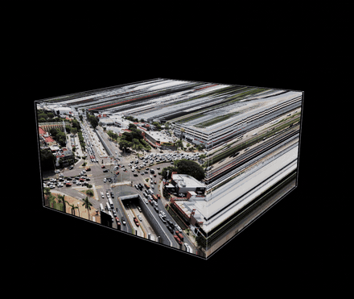

# GARGANTUA

**A browser-based space-time cube viewer.** Give it any video of up to 15 seconds and it builds an
interactive 3D block, x and y across the image and time along the depth. You can orbit it, dissolve it
into smoke, fly through it and export it. The look follows a reference reel: a solid box that dissolves
into a smoke of raw video colour, where static scenery stays sharp and moving things smear into ghosts
along time.



<sub>Demo: footage "Ruiz Cortines y Paseo Tabasco" by ProtoplasmaKid, CC BY-SA 4.0, via Wikimedia Commons, rendered by GARGANTUA (GIF CC BY-SA 4.0, see `docs/media/`).</sub>

GARGANTUA is **not a trained model**. It is classical computer vision (OpenCV optical flow, KLT tracking,
temporal statistics) plus a GPU ray-marcher written for this project.

> Using it from an AI coding agent: [`AGENTS.md`](AGENTS.md).
> Status, phases and every measurement: [`PROGRESS.md`](PROGRESS.md). Bench results:
> [`docs/BENCH.md`](docs/BENCH.md). Reel analysis: [`docs/REEL_ANALYSIS.md`](docs/REEL_ANALYSIS.md).

---

## Quick start (tested on Windows 11; macOS/Linux untested)

Requirements: Node 22, Python 3.11 with [uv](https://docs.astral.sh/uv/), ffmpeg/ffprobe on `PATH`, and
Google Chrome (used for headless export; no browser is downloaded).

```bash
git clone https://github.com/OWNER/gargantua && cd gargantua
npm ci --ignore-scripts                       # viewer + tools
uv sync --project pipeline                    # Python pipeline (numpy, opencv-python-headless)
npm run dev                                   # http://127.0.0.1:5178
```

Drop a video on the page. A clip longer than 15 s first opens a trim dialog (preview plus a 15 s window
slider, default the first 15 s). The local dev server runs the Python pipeline and streams its progress to
the page, then opens the cube. Without the server (a static `npm run build` hosted anywhere), a dropped video
is decoded in the browser instead: REEL mode only, with no evidence field, worldlines or quality score.

Command line:

```bash
pipeline/.venv/Scripts/python -m gargantua build clip.mp4 -o work/volumes/clip.gvol   # video -> volume
pipeline/.venv/Scripts/python -m gargantua analyze clip.mp4                           # quality score only
node tools/export/export.mjs --vol work/volumes/clip.gvol --preset portrait --audio clip.mp4 \
     --out work/export/clip_1080x1920.mp4                                             # 60 fps H.264
node tools/export/export.mjs --vol work/volumes/clip.gvol --preset 4k --out work/export/clip_4k.mp4
node tools/export/export.mjs --vol work/volumes/clip.gvol --preset portrait --duration 30 --clean      --out work/export/clip_reel_30s.mp4    # the reel sequence slowed to 30 s, REEL look, no overlays or labels
```

## How it works

```
video ──ffprobe/ffmpeg──► ingest ──► camera motion ──► analyzer ──► evidence field ──► worldlines ──► .gvol
        trim to 15 s,      KLT + RANSAC      quality score,   median / mode /        KLT tracks
        resample to <=30,  similarity,       category,        capped-mode hybrid     (x, y, t)
        autorotate,        static/drift/     preset           background, motion,
        tone-map HDR,      pan/handheld,                      flow, flicker mask
        scale to a tier    stabilise drift
                                                                                        │
viewer (Vite + TypeScript + three.js, WebGL2) ◄──────────────────────────────────────────┘
  3D-texture ray-march (front-to-back, blue-noise jitter, early exit, empty-space skipping, adaptive steps,
  progressive refinement when idle) -> thick-line overlays (wireframe faded by transmittance, slice frame,
  worldlines, camera path) -> bloom -> ACES + vignette + grain
```

- **Volume:** RGBA8 3D texture. RGB is the raw video colour; A is the evidence that a voxel belongs to something moving. Tiers are S (360 short side), M (540) and L (720), at most 2048 per axis, because WebGL2's `MAX_3D_TEXTURE_SIZE` is 2048 here. The highest tier that fits the 1.1 GB budget is chosen; landscape 15 s clips land on 960×540×450.
- **REEL mode:** the raw colour volume at low opacity. **Solid ↔ smoke** is a time threshold τ: voxels after τ are solid, before τ smoke, and the cut face shows frame τ. This was measured from the reel.
- **SEPARATED mode:** density comes from the evidence field instead, so only moving things remain. The **RAW ↔ SEPARATED** slider blends the two continuously, and auto density keeps the mean optical depth constant.
- **Animated screens** are regions whose brightness keeps changing without steady motion to account for it, in the bright end of the frame (hysteresis: a solid strict seed, grown over relaxed gates, then a convex hull). You choose whether they stay as streaks, count as scenery, or are suppressed. Only for still or stabilised cameras: under a pan or a walk, screens slide across the frame and no fixed mask is stored.
- **Worldlines:** KLT tracks with a forward-backward check and re-seeding, filtered to real movers. They are drawn as glowing additive (x, y, t) lines coloured by direction, speed or sampled colour.
- **Camera motion:** classified as static, drift, pan or hand-held from a keyframe-based similarity path plus a long-baseline parallax residual. Drift is stabilised only when it measurably sharpens the scene. Hand-held clips are shown raw, with the camera path drawn as a worldline and a warning.
- **Look Director:** the reel's constants (smoke optical depth, exposure, box depth 1.04 × width, 35° field of view) were fitted by rendering. Night scenes get a measured exposure lift, and only night scenes feed emissive pixels into the bloom. Presets per category (sparse overhead, dense crowd, night lights, hand-held, nature) can be saved and loaded as JSON.

## Controls

| Input | Action |
|---|---|
| drag / right-drag / wheel | orbit / pan / zoom (touch: one finger orbit, two fingers zoom and pan) |
| Space, ← → (Shift ×10) | play / pause the clip cursor, step frames |
| D | play the reel camera sequence (orbit, dissolve, oblique, fly inside, fly out, hero orbit) |
| 1-6 | camera presets: reel, front, side, top, back, inside |
| F | free fly (W A S D, Q / E, Shift faster, Esc) |
| M · T · [ ] | REEL / SEPARATED · solid / dissolved · smoke density |
| S W B G L P | layers: smoke, worldlines, wireframe, guides, labels, context plate |
| O · H · ? | open a file · hide the interface · help |

The panel adds the RAW ↔ SEPARATED slider, screen handling (keep / scenery / suppress), threshold and
direction, layer settings, look settings (exposure, saturation, glow, emissive, grain, vignette, box depth),
preset save/load, and a performance readout with measured fps, GPU time and estimated VRAM. The quality
panel shows the clip's grade with its reasons. The transport bar has the clip scrubber, playback speed,
"reveal" (the cube grows with playback) and the director timeline with seekable keyframes. You can drop a
video, a `.gvol` or a preset `.json` anywhere.

## Tests

```bash
cd pipeline && uv run pytest && uv run ruff check src tests ../bench ../tools   # pipeline
npm test && npm run typecheck                                                  # viewer logic
node tools/e2e/ui_check.mjs                                                    # every UI control, headless Chrome
```

## Measured results

All measured on Windows 11, RTX 5070, headless Chrome 155, in the final run (2026-10-17). Full tables:
[`docs/BENCH.md`](docs/BENCH.md); phase-by-phase evidence: [`PROGRESS.md`](PROGRESS.md).

| what | result |
|---|---|
| Your night clip | 960x540x422 volume, built in 160 s; camera drift, stabilised (sharpness x1.91); grade **OK** |
| Your 4K walk | 720x1280x279 volume; grade **Poor**: large camera motion, forward motion (scale 49%), strong parallax, raw frames unaligned |
| Speed at 1080p, smallest tier | 714-1000 fps moving, 455-556 fps idle (target >= 60) |
| Speed at 1080p, largest tiers | your clips 72-90 fps moving, 46-52 fps idle (target >= 30); 16 real clips >= 56 fps moving |
| VRAM | 0.44-0.60 GB (S tier), about 1.2 GB (largest tiers), on a 12 GB card |
| Reel Replica Test | PASS: statics sharp head-on (0.551 vs 0.021 oblique), movers ghost (0.581 < 0.75), stripes in the smoke (0.103 REEL vs 0.0073 SEPARATED) |
| Look calibration | reel top-down haze 0.371 → render 0.378; reel 1.7 s smoke band 0.253 → 0.247 |
| Framing | hero box 0.910 x 0.609 of the frame vs the reel's 0.903 x 0.610 |
| Background (synthetic, MAE 0-255) | dense crowd: median 4.64 → hybrid 1.03; never worse than the median |
| Worldlines (synthetic) | 90-100% of movers covered, 0.20-0.41 px/frame velocity error |
| Camera path (synthetic) | 0.006 px error on drift, 0.026 px on pan |
| Animated screens | synthetic IoU 0.84; your clip: 4 labelled screens 85-94% covered, crowd 0% |
| Exports | 1080x1920 and 3840x2160, 60 fps, 673 frames (11.2 s reel sequence), H.264 High yuv420p + AAC from the source; a re-rendered frame hashes identically; 0 decode errors; rendered in 325 s / 1119 s |
| Tests | 58 pytest, 25 node tests, 72 headless UI checks, 0 console errors |

## Honest limits

- **The reel's look depends on its footage.** It works when a static scene fills the frame and a few things move over it, as in an overhead crossing. Dense crowds turn REEL smoke into mud; use SEPARATED mode plus worldlines. Night scenes give dark smoke even with the exposure lift.
- **A moving camera breaks the cube.** Pans, walks and drones that move all smear static content along time. Drift is stabilised (similarity model); real pans and hand-held walks are shown raw with a warning. **Parallax cannot be corrected**: no 2D alignment can register near and far at once.
- **Weak clip types** (the analyzer scores them OK or Poor and says why): hand-held or walking footage; pans; forward motion; very dense or uniformly dark crowds, where the background estimate fails below ~10% visibility and "dark clothing" becomes the most frequent colour; old film with gate weave, where the camera label reads "hand-held" because it measures frame jitter; screen recordings and full-screen graphics; and clips under 2 s.
- **The reel calibration is approximate.** It is fitted on a synthetic overhead crossing, not on the reel's own footage. At the reel's camera poses it reproduces the two fitted reel measurements within 2% (top-down haze 0.378 against 0.371, 1.7 s smoke band 0.247 against 0.253). The unfitted inside view comes out brighter than the reel (0.72 against 0.56). Linear-light and display-space blending fit about equally well, and only that one unfitted check slightly favours linear (section 8 of the reel analysis lists two earlier, corrected claims).
- **Inside-the-box shots are approximate.** The fly-inside segment follows the reel's timing (jump-cut inside at 5.8 s, smoke all around, slice frame visible), but the reel's inside shots look wider-angle than its outside shots; the viewer keeps one 35° lens throughout.
- **Separating the background** uses a hybrid of median, mode and run-capped mode. It beats the median whenever the background is visible 15-50% of the time, and every estimator fails below ~10%.
- **No depth and no segmentation.** Movers are pixels that differ from the background or move. Shadows count as movers, and animated screens are flagged by a heuristic: IoU 0.84 on the bench's synthetic screens, and on your night clip 4 hand-labelled screens are 85-94% covered while the crowd and a lit facade are 0% (`tools/bench/flicker_regions.py`, approximate labels). Static lit signs are not screens and stay unflagged; screens whose content barely changes over the clip are missed.
- **Fly mode** uses pointer lock when the browser grants it (verified in headless Chrome: a held W moved the camera, the mouse turned it, Escape exited). Where pointer lock is refused (embedded browsers), it falls back to drag-to-look. Entering the fallback and turning were verified in such an embedded browser; movement there could not be measured, because that pane runs no animation frames. Both modes share the same movement code.
- **Platform:** developed and measured on Windows 11, an RTX 5070 and Chrome 155. Other GPUs and browsers are untested.
- **Volume size ceiling:** a 1280x720x449 volume (1.66 GB) uploaded without any error but never drew; 1.03 GB volumes draw. The automatic tier choice stays under 1.1 GB; a forced `--tier L` on a long landscape clip can exceed it, and the exporter now refuses to render when the cube does not appear.
- **The in-browser fallback** (no Python server) samples at a fixed 30 fps and has no evidence field, worldlines or quality score.
- **Night scenes with large bright areas** (clipped sky in a time-lapse, walls of billboards) get a proportionally smaller emissive boost and bloom; they can still look bright, because the night exposure lift raises everything. A clip that opens on black frames shows a black front face on the solid box.
- **The heaviest volume refines more slowly when the camera is still.** Every animated view renders at the interactive quality (at least 56 fps on every measured volume), but the full-quality idle pass on the largest corpus volume (836x720x450, 1.08 GB) runs at 26 fps; `--tier M` gives it 70 fps (`docs/BENCH.md` section 3). Idle rates vary by about ±25% with the orbit sampled.

## Licenses

MIT (`LICENSE`). Third-party components and what the binary wheels bundle are listed in
[`docs/LICENSES.md`](docs/LICENSES.md); bench clips and their licenses are in
[`docs/CLIP_LICENSES.md`](docs/CLIP_LICENSES.md). The reference reel and the input clips are never
committed. No code was copied from other repositories.

## Layout

```
pipeline/src/gargantua/   probe, ingest, camera, evidence, worldlines, analyze, look, pack (.gvol), synth, cli
pipeline/tests/           pytest suite (synthetic truth + your real clips when present)
viewer/src/               io (gvol, loader, quick ingest), render (shaders, volume, lines, overlays, worldlines,
                          pipeline), director, look, ui, export (automation hooks)
viewer/tests/             node --test suite (parser against real Python output, director, blue noise, math)
tools/                    p0 env report, p1 reel measurements, bench (perf, calibrate, contact, replica),
                          export (deterministic 60 fps export), e2e (UI check), lib (static server)
bench/                    synthetic bench, corpus builder, report generator
docs/                     REEL_ANALYSIS, BENCH, LICENSES, CLIP_LICENSES, evidence/
```
